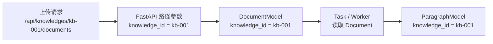

# 数据库与 ORM 基础学习笔记

## 1. 数据库里的基本结构

本项目支持两套数据库运行方式：

```text
本地默认：SQLite 保存业务数据，Chroma 保存向量
生产模式：PostgreSQL 同时保存业务数据和 pgvector 向量
```

数据库中共有 11 张 ORM 表：

```text
knowledge_folder
knowledge
file
document
paragraph
problem
problem_paragraph_mapping
embedding_ref
task
task_attempt
outbox_event
```

以 `document` 表为例：

```text
id        knowledge_id    name        char_length
doc-001   kb-001          产品手册.md   3200
doc-002   kb-001          FAQ.txt      1800
```

基础概念：

```text
数据库（Database）  保存多张表
表（Table）         保存同一类数据
行（Row）           一条具体记录
列（Column）        记录中的一个字段
```

上面的 `document` 是表，`doc-001` 所在行是一条记录，`name` 是一个字段。

## 2. ORM 是什么

ORM 负责建立 Python 与数据库之间的映射：

```text
Python 类      <-> 数据库表
Python 属性    <-> 表字段
Python 对象    <-> 表中的一行记录
```

这里的 `<->` 不是“完全相等”，而是：

```text
SQLAlchemy 知道它们之间的对应关系，并负责相互转换。
```

本项目使用 SQLAlchemy ORM。例如：

```python
class DocumentModel(Base):
    __tablename__ = "document"

    id: Mapped[str] = mapped_column(String(64), primary_key=True)
    name: Mapped[str] = mapped_column(String(255))
```

这段代码描述的是表结构：

```text
DocumentModel 类           document 表
DocumentModel.id 属性      document.id 字段
DocumentModel.name 属性    document.name 字段
```

它类似于先规定一个表格有哪些列：

```text
document 表

id        name
```

此时只有表结构，还没有表示某一篇具体文档。

创建一个模型实例：

```python
document = DocumentModel(
    id="doc-001",
    knowledge_id="kb-001",
    name="产品手册.md",
    file_path="/uploads/产品手册.md",
    char_length=3200,
)
```

这个 Python 对象中的具体值：

```text
document.id      是 "doc-001"
document.name    是 "产品手册.md"
```

保存到数据库后，对应 `document` 表中的一行：

```text
id        name
doc-001   产品手册.md
```

保存操作：

```python
db.add(document)
db.commit()
```

因此，最简记忆是：

```text
模型类         定义一张表的结构
模型类的属性   定义表中的列
模型实例       表示一条具体记录
实例的属性值   表示这一行中具体字段的值
```

严格来说，刚创建的 `document` 对象只是“一条准备保存的记录”；执行 `db.add()` 和 `db.commit()` 后，数据才真正保存为数据库中的一行。

## 3. SQLAlchemy 是什么

一句话：

```text
SQLAlchemy 是 Python 的数据库工具箱。
它负责连接数据库、生成并执行 SQL，也支持通过 Python 类和对象操作数据。
```

需要先区分：

```text
SQLite / PostgreSQL   是数据库，真正保存数据
SQLAlchemy   是 Python 与数据库之间的操作层
```

可以把数据库想成“仓库”，把 SQL 想成“仓库操作指令”，SQLAlchemy 则像一个 Python 操作员：

```text
Python 业务代码
-> SQLAlchemy 理解操作
-> 生成并执行 SQL
-> SQLite 或 PostgreSQL 读取、保存数据
```

### 3.1 它解决什么问题

不使用 SQLAlchemy，需要直接编写 SQL：

```python
cursor.execute(
    "SELECT * FROM document WHERE id = ?",
    (document_id,),
)
row = cursor.fetchone()
```

使用 SQLAlchemy ORM：

```python
document = db.get(DocumentModel, document_id)
```

SQLAlchemy 会在底层构造并执行类似的查询：

```sql
SELECT * FROM document WHERE id = ?;
```

然后把查询结果转换成 `DocumentModel` 实例。

因此，代码中虽然主要在操作 Python 对象，最终执行的仍然是数据库能够理解的 SQL。

### 3.2 它在本项目中负责什么

```text
engine         建立数据库入口
SessionLocal   创建 Session
Session / db   管理一次数据库操作
Base           注册 ORM 模型
Model          描述数据库表
select         构造查询
```

对应代码：

```python
engine = create_engine(DATABASE_URL)
```

表示创建数据库连接入口。

```python
class DocumentModel(Base):
    __tablename__ = "document"
```

表示定义 `document` 表对应的 ORM 模型。

```python
document = db.get(DocumentModel, document_id)
```

表示按照主键查询一篇文档。

### 3.3 优点

```text
常规 CRUD 不需要反复手写 SQL
查询结果可以直接作为 Python 对象使用
参数绑定可以降低 SQL 注入风险
统一管理数据库连接、Session 和事务
减少切换数据库时需要修改的业务代码
```

### 3.4 限制

- ORM 会隐藏 SQL，仍需关注最终查询是否高效。
- 关联数据使用不当可能产生 N+1 查询。
- 复杂查询仍可能需要 SQLAlchemy Core 或原生 SQL。
- 更换数据库可以降低改造成本，但不代表完全不用修改。
- 仍然需要理解 Session、事务、索引和表关系。

最简记忆：

```text
数据库负责保存数据。
SQLAlchemy 负责让 Python 更方便地操作这些数据。
```

## 4. 如何读懂模型定义

### 4.1 `class DocumentModel(Base)`

这是 Python 的类继承语法，类似 TypeScript：

```typescript
class DocumentModel extends Base {}
```

`Base` 是所有 SQLAlchemy 模型的公共基类：

```python
class Base(DeclarativeBase):
    pass
```

模型继承 `Base` 后，SQLAlchemy 才能识别并收集它的表结构。

项目启动时：

```python
Base.metadata.create_all(bind=engine)
```

SQLAlchemy 会根据模型定义创建尚不存在的表。

### 4.2 `__tablename__`

```python
class DocumentModel(Base):
    __tablename__ = "document"
```

表示：

```text
Python 模型类名：DocumentModel
数据库表名：document
```

### 4.3 `Mapped` 和 `mapped_column`

```python
name: Mapped[str] = mapped_column(String(255), index=True)
```

拆开理解：

```text
Mapped[str]                  Python 中该属性是字符串
mapped_column(String(255))   数据库中该列保存字符串
index=True                   给该列建立索引
```

本项目常见类型：

```text
Mapped[str]        <-> String / Text
Mapped[int]        <-> Integer
Mapped[datetime]   <-> DateTime
```

## 5. 常见字段配置

### 主键 `primary_key`

```python
id: Mapped[str] = mapped_column(
    String(64),
    primary_key=True,
    default=new_id,
)
```

主键用于唯一标识一条记录。本项目使用 UUID 字符串作为主键。

### 外键 `ForeignKey`

```python
knowledge_id: Mapped[str] = mapped_column(
    String(64),
    ForeignKey("knowledge.id"),
    index=True,
)
```

`ForeignKey("knowledge.id")` 表示：

```text
document.knowledge_id 指向 knowledge.id
```

也就是“这篇文档属于哪个知识库”。

### 索引 `index`

```python
name: Mapped[str] = mapped_column(String(150), index=True)
```

索引可以加快常用字段的查询和排序，但也会增加存储与写入成本。

### 唯一约束 `unique`

```python
vector_id: Mapped[str] = mapped_column(
    String(128),
    unique=True,
    index=True,
)
```

`unique=True` 表示不同记录不能使用相同的 `vector_id`。

### 默认值 `default`

```python
char_length: Mapped[int] = mapped_column(Integer, default=0)
created_at: Mapped[datetime] = mapped_column(DateTime, default=now)
```

函数作为默认值时，要传函数本身：

```python
default=new_id
default=now
```

不要写成 `default=new_id()` 或 `default=now()`，否则函数会在定义模型时提前执行。

### 自动更新时间 `onupdate`

```python
updated_at: Mapped[datetime] = mapped_column(
    DateTime,
    default=now,
    onupdate=now,
)
```

首次创建时使用 `default`，以后更新记录时使用 `onupdate`。

## 6. 一个项目中如何划分表

### 6.1 先从业务名词中找候选对象

设计表之前，先说清楚系统要管理什么。

本项目当前需要管理三组职责：

```text
核心业务：
文件夹、知识库、原始文件、文档、段落

增强检索：
问题、问题与段落映射、向量引用

任务可靠性：
任务、执行记录、待投递事件
```

这些有独立身份和生命周期的对象最终形成 11 张表：

```text
KnowledgeFolderModel
KnowledgeModel
FileModel
DocumentModel
ParagraphModel
ProblemModel
ProblemParagraphMappingModel
EmbeddingRefModel
TaskModel
TaskAttemptModel
OutboxEventModel
```

注意：

```text
业务名词只是寻找候选表的起点，不是每个名词都必须单独建表。
```

### 6.2 判断“字段还是独立表”

可以把数据库想成多个表格。

如果某个信息只是描述当前对象的一个简单值，通常作为字段：

```text
文档名称       -> document.name
文档状态       -> document.status
错误信息       -> document.error_message
段落字符数     -> paragraph.chunk_length
```

如果某个对象满足下面一个或多个条件，通常考虑单独建表：

```text
有自己的唯一 ID
一条父记录下可能有多条
有自己的创建、更新或删除生命周期
需要被独立查询、排序或建立索引
还会继续关联其他对象
```

例如，一篇文档会切出多个段落：

```text
Document
├── Paragraph 1
├── Paragraph 2
└── Paragraph 3
```

如果把全部段落直接塞进 `document` 的一个字段：

```text
document.paragraphs = "段落1、段落2、段落3……"
```

后续会很难：

```text
单独查询某个段落
按照 position 排序
给每个段落建立向量
只更新或删除某个段落
```

所以 `Paragraph` 应该是独立表，而不是 `Document` 的普通字段。

### 6.3 一个实用判断表

| 问题          | 更适合字段   | 更适合独立表 |
| ----------- | ------- | ------ |
| 每条父记录有几个值？  | 固定一个简单值 | 可能有多个  |
| 是否需要自己的 ID？ | 不需要     | 需要     |
| 是否独立增删改查？   | 不需要     | 需要     |
| 是否有独立生命周期？  | 没有      | 有      |
| 是否还要关联其他对象？ | 不会      | 会      |

这不是绝对规则，但足够帮助初学者完成第一轮判断。

### 6.4 为什么本项目有单独的 `file` 表

当前项目使用 `FileModel` 保存原始文件元数据：

```text
file.file_name
file.file_size
file.sha256_hash
file.file_path
```

`DocumentModel.source_file_id` 通过外键指向 `file.id`。这样原始文件的名称、大小、哈希和存储位置可以独立查询，也为以后切换对象存储保留稳定边界。

`document.file_path` 目前仍然存在，但只是为了兼容旧 SQLite 表中的非空字段；当前业务读取统一通过：

```text
document.source_file_id
-> file.id
-> file.file_path
```

这说明是否拆表取决于对象是否已有独立职责，而不是字段数量。

## 7. 如何判断表之间的关系

不要先想 `relationship()` 怎么写。先用业务语言问两个方向的问题：

```text
一个 A 可以对应几个 B？
一个 B 又可以对应几个 A？
```

答案决定关系类型：

| A 对应 B | B 对应 A | 关系  |
| ------ | ------ | --- |
| 一个     | 一个     | 一对一 |
| 多个     | 一个     | 一对多 |
| 多个     | 多个     | 多对多 |

### 7.1 一对一

例子：

```text
一个用户只有一份个人档案
一份个人档案只属于一个用户
```

结构：

```text
user
└── profile
```

通常在依赖另一方的表中保存外键，并加唯一约束：

```text
profile.user_id -> user.id
profile.user_id 必须 unique
```

本项目中，`Problem` 和它自己的 `EmbeddingRef` 按一对一使用：

```text
一个问题最多对应一条问题向量引用
一条问题向量引用最多指向一个问题
```

数据库通过 `embedding_ref.problem_id` 的唯一约束保证一个问题不会重复建立多条向量引用。

段落和向量引用不是一对一。一个段落既可以有自己的段落向量，也可以作为问题向量的回源段落，因此 ORM 使用 `paragraph.embedding_refs` 列表表达一对多关系。

### 7.2 一对多

本项目中：

```text
一个 Knowledge 有多个 Document
一个 Document 只属于一个 Knowledge
```

因此是：

```text
Knowledge 1 -> N Document
```

一对多关系的外键通常放在“多”的一方：

```text
document.knowledge_id -> knowledge.id
```

同理：

```text
Document 1 -> N Paragraph
paragraph.document_id -> document.id
```

文件夹和知识库也是一对多：

```text
KnowledgeFolder 1 -> N Knowledge
knowledge.folder_id -> knowledge_folder.id
```

记忆方式：

```text
谁属于谁，谁就保存对方的 ID。
```

### 7.3 自关联关系

有时一张表需要关联自己。

本项目的文件夹可以包含子文件夹：

```text
产品资料
├── 使用手册
└── 常见问题
```

父文件夹和子文件夹都是同一种对象，所以不需要分别建立两张表。让 `parent_id` 指向同一张表的 `id` 即可：

```text
knowledge_folder.parent_id -> knowledge_folder.id
```

这仍然是一对多：

```text
一个父文件夹可以有多个子文件夹
一个子文件夹最多有一个父文件夹
```

根文件夹没有父级，因此 `parent_id` 可以为 `None`。

SQLAlchemy 中的 `remote_side` 用来说明自关联关系的哪一列代表父级：

```python
parent: Mapped[Optional["KnowledgeFolderModel"]] = relationship(
    back_populates="children",
    remote_side="KnowledgeFolderModel.id",
)
```

数据库外键只能保证父文件夹存在，不能阻止 `A -> B -> A` 这样的循环，所以创建或移动文件夹时还需要 service 层检查是否形成环。

### 7.4 多对多

例子：

```text
一个用户可以拥有多个角色
一个角色也可以分配给多个用户
```

不能只在其中一张表放一个外键，因为双方都有多个。

通常增加一张中间表：

```text
user
role
user_role
```

`user_role` 保存两边的 ID：

```text
user_id -> user.id
role_id -> role.id
```

一行表示一组关系：

```text
user-001 | role-admin
```

通常还会限制 `(user_id, role_id)` 不能重复。

当前项目的 `Problem` 和 `Paragraph` 已经构成多对多数据模型：

```text
Problem
-> ProblemParagraphMapping
-> Paragraph
```

一条问题可以关联多个段落，一个段落也可以关联多个问题。中间表还保存 `knowledge_id` 和 `document_id`，便于按知识库、文档过滤和清理映射。

### 7.5 外键放在哪里

最小规则：

```text
一对多   外键放在“多”的一方
一对一   外键放在依赖的一方，并加 unique
多对多   新建中间表，中间表保存两边外键
```

表关系首先是业务规则，`ForeignKey` 和 `relationship()` 只是把这个规则写进数据库和代码。

## 8. 本项目 11 张表为什么这样设计

```text
KnowledgeFolderModel
    ├── KnowledgeFolderModel（子文件夹）
    └── KnowledgeModel
            ├── DocumentModel
            │       ├── FileModel
            │       ├── ParagraphModel
            │       │       ├── EmbeddingRefModel
            │       │       └── ProblemParagraphMappingModel
            │       │               └── ProblemModel
            │       └── TaskModel
            │               ├── TaskAttemptModel
            │               └── OutboxEventModel
            └── ProblemModel
```

业务含义：

```text
一个文件夹可以有多个子文件夹
一个文件夹可以有多个知识库
一个知识库也可以不属于任何文件夹
一个知识库可以有多篇文档
一份原始文件可以被文档引用
一篇文档可以切成多个段落
问题与段落通过映射表形成多对多关系
段落和问题可以拥有向量引用
一篇文档可以产生多次后台任务
一个任务可以有多次执行记录和多条投递事件
```

每张表只负责一种对象或关联：

| 分组 | 表 | 保存什么 |
|---|---|---|
| 核心业务 | `knowledge_folder` | 文件夹信息和父目录 ID |
| 核心业务 | `knowledge` | 知识库名称、描述和检索配置 |
| 核心业务 | `file` | 原始文件名称、大小、哈希和路径 |
| 核心业务 | `document` | 文档归属和当前处理状态 |
| 核心业务 | `paragraph` | 切分后的正文、标题和顺序 |
| 增强检索 | `problem` | 更接近用户表达的增强问题 |
| 增强检索 | `problem_paragraph_mapping` | 问题和段落的多对多关系 |
| 增强检索 | `embedding_ref` | 向量来源、稳定 ID 和可选 pgvector 向量 |
| 任务可靠性 | `task` | 后台任务当前状态和执行权 |
| 任务可靠性 | `task_attempt` | 每一次任务执行历史 |
| 任务可靠性 | `outbox_event` | 与业务事务一起创建的待投递事件 |

关键外键：

```text
knowledge_folder.parent_id  -> knowledge_folder.id
knowledge.folder_id         -> knowledge_folder.id
document.source_file_id     -> file.id
document.knowledge_id       -> knowledge.id
paragraph.document_id       -> document.id
problem.knowledge_id        -> knowledge.id
mapping.problem_id          -> problem.id
mapping.paragraph_id        -> paragraph.id
embedding_ref.paragraph_id  -> paragraph.id
embedding_ref.problem_id    -> problem.id
task.document_id            -> document.id
task_attempt.task_id        -> task.id
outbox_event.task_id        -> task.id
```

### 8.1 为什么 `folder_id` 可以为空

`knowledge.folder_id` 是可空外键：

```text
有 folder_id     知识库位于某个文件夹中
folder_id=None   知识库位于根级
```

这里的“可空”表达了一条真实业务规则，而不只是为了少做校验。

### 8.2 为什么状态是字段，不是单独的表

```text
document.status
document.error_message
```

它们仍然只描述某一篇文档当前的处理结果，因此直接放在 `document` 表中。

当前项目另外使用任务表保存后台处理过程：

```text
task           保存当前任务状态
task_attempt   保存每一次执行的时间、Worker 和错误
```

`document.status` 方便文档列表直接展示，`task_attempt` 则负责回答“之前每一次执行发生了什么”。两者职责不同。

### 8.3 为什么 `paragraph` 还保存 `knowledge_id`

只通过 `paragraph.document_id`，其实也能先找到文档，再找到知识库：

```text
paragraph.document_id
-> document.knowledge_id
-> knowledge.id
```

当前项目额外保存 `paragraph.knowledge_id`，是为了按知识库过滤段落时更直接。

这是用少量重复数据换取查询方便：

```text
优点   少一次关联查询
代价   写入时必须保证 document_id 和 knowledge_id 对应一致
```

这种做法叫“反规范化”。初学阶段只需记住：重复字段必须有明确收益，否则优先避免重复保存同一事实。

### 8.4 两个 `knowledge_id` 从哪里来

前面示例中的 `kb-001` 只是为了方便阅读而写的示例值。

项目实际创建知识库时，`KnowledgeModel.id` 会通过 `new_id` 自动生成：

```python
id: Mapped[str] = mapped_column(
    String(64),
    primary_key=True,
    default=new_id,
)
```

上传文档时，调用方把这个知识库 ID 放进请求 URL：

```text
POST /api/knowledges/kb-001/documents
```

FastAPI 从 URL 中解析出：

```python
knowledge_id = "kb-001"
```

随后，`knowledge_id` 先写入 `document`，后台 Worker 再从这条持久化记录传给段落准备逻辑：



第一步，API 接收 URL 中的路径参数，并传给 Service：

```python
@router.post("/api/knowledges/{knowledge_id}/documents")
async def upload_document_api(knowledge_id: str, ...):
    document, task = await create_document_task(
        db=db,
        knowledge_id=knowledge_id,
        ...,
    )
```

第二步，创建文档时把参数写入 `document.knowledge_id`：

```python
document = DocumentModel(
    knowledge_id=knowledge_id,
    ...
)
```

第三步，Worker 读取 `DocumentModel` 后，把其中的 `knowledge_id` 传入 `_prepare_document_index`：

```python
prepared_index = _prepare_document_index(
    knowledge_id=knowledge_id,
    document_id=document_id,
    ...
)
```

第四步，创建每个段落时把参数写入 `paragraph.knowledge_id`：

```python
ParagraphModel(
    knowledge_id=knowledge_id,
    document_id=document_id,
    ...
)
```

所以这里不是数据库把值从 `document` 自动复制到 `paragraph`：

```text
错误理解：
document.knowledge_id
        ↓ 数据库自动复制
paragraph.knowledge_id
```

实际情况是 Service 使用同一个函数参数进行了两次赋值：

```text
同一个 knowledge_id 参数
├──> document.knowledge_id
└──> paragraph.knowledge_id
```

其中，`paragraph.document_id = document.id` 才表示“这个段落属于这篇文档”。

数据库只能分别检查两个 `knowledge_id` 是否指向有效知识库，不能自动检查它们是否属于同一条文档链路。因此下面这种错误数据仍可能通过单个外键校验：

```text
document.id           = doc-001
document.knowledge_id = kb-001

paragraph.document_id  = doc-001
paragraph.knowledge_id = kb-002
```

`kb-001` 和 `kb-002` 如果都是有效知识库，两个外键各自都合法，但段落的知识库归属已经和所属文档矛盾。

一句话总结：两个值都来自上传接口收到的同一个知识库 ID，只是 Service 分别把它保存到了两张表。

## 9. 外键和 `relationship` 的区别

外键保存真实的关联 ID，属于数据库结构：

```python
ForeignKey("document.id")
```

`relationship` 让 Python 对象可以访问关联对象：

```python
paragraphs: Mapped[list["ParagraphModel"]] = relationship(
    back_populates="document",
    cascade="all, delete-orphan",
)
```

有了它，可以这样访问：

```python
document.paragraphs
paragraph.document
```

最小区别：

```text
ForeignKey     数据库通过哪个字段建立关联
relationship  Python 代码如何访问关联对象
```

`back_populates` 表示两个属性是同一组双向关系：

```text
document.paragraphs  <->  paragraph.document
```

`cascade="all, delete-orphan"` 表示父对象被删除或子对象失去父对象时，相关子对象也随之删除。本项目中，文档不存在后，它的段落也不应独立存在。

注意：`document.paragraphs` 是 ORM 对象关系，不是 `document` 表中真实存在的字段。真正保存关联的是 `paragraph.document_id`。

## 10. 如何查询数据

### 按主键查询一条：`db.get`

```python
knowledge = db.get(KnowledgeModel, knowledge_id)
```

两个参数分别是：

```text
KnowledgeModel   查询哪个 ORM 模型，也就是哪张表
knowledge_id     要查询的主键值
```

结果：

```text
查到      返回一个 KnowledgeModel 实例
查不到    返回 None
```

`db.get` 主要用于按主键查询，不用于任意字段查询。

### 按条件查询多条：`select`

```python
statement = (
    select(DocumentModel)
    .where(DocumentModel.knowledge_id == knowledge_id)
    .order_by(DocumentModel.created_at.desc())
)
documents = list(db.scalars(statement).all())
```

逐步理解：

```text
select(DocumentModel)                     查询文档表
where(DocumentModel.knowledge_id == ...)  只保留指定知识库的文档
order_by(...desc())                       按创建时间降序
db.scalars(statement)                     取出 ORM 实例
all()                                     获取全部结果
```

最终得到 `list[DocumentModel]`，每个元素对应一条文档记录。

## 11. 如何新增数据

本项目创建知识库：

```python
knowledge = KnowledgeModel(
    name=payload.name,
    description=payload.description,
)
db.add(knowledge)
db.commit()
db.refresh(knowledge)
```

执行顺序：

```text
创建模型实例
-> add：交给 Session 管理
-> commit：正式提交事务
-> refresh：读取数据库中的最新值
```

需要记住：

```text
db.add() 不等于已经永久保存。
通常执行 db.commit() 后，数据才会正式持久化。
```

上传文档时还会使用 `flush()`：

```text
flush     同步当前变更，拿到生成的 ID，但不结束事务
commit    正式提交整个事务
refresh   从数据库重新读取对象的最新字段
```

Session 和事务的完整说明见 `sqlalchemy-session-learning.md`。

## 12. 两套存储模式的分工

本地默认模式：

```text
SQLite   保存文件夹、知识库、文档、段落等业务数据
Chroma   保存 embedding 向量并执行相似度检索
```

它们通过向量 ID 建立联系：

```text
SQLite 中的 paragraph
-> embedding_ref.vector_id
-> Chroma 中的真实向量
```

此时 `embedding_ref.embedding` 为空，`EmbeddingRefModel` 主要保存业务来源和 Chroma `vector_id` 的对应关系。

PostgreSQL 模式：

```text
PostgreSQL 普通列       保存业务数据和向量元数据
pgvector 向量列         保存 embedding 并执行相似度检索
PostgreSQL tsvector     支持关键词检索
```

此时真实向量直接保存在 `embedding_ref.embedding`，业务数据与向量可以共享同一个数据库事务。

两种模式都通过 `EmbeddingRepository` 暴露统一接口。区别在于：

```text
Chroma 模式      跨两个存储，失败时需要补偿
pgvector 模式    同一数据库事务可以整体提交或回滚
```

## 13. 设计表关系时的步骤

面对一个新项目时，可以按下面的顺序思考。

### 第一步：用业务语言描述事实

先不考虑数据库语法：

```text
文件夹包含子文件夹和知识库
知识库包含文档
文档包含段落
段落对应向量
```

### 第二步：识别需要独立管理的对象

检查它是否需要：

```text
自己的 ID
独立查询
独立增删改
独立生命周期
继续关联其他数据
```

满足这些条件的对象通常适合独立建表。

### 第三步：从两个方向判断数量

```text
一个知识库有几篇文档？      多篇
一篇文档属于几个知识库？    一个
```

所以是：

```text
Knowledge 1 -> N Document
```

### 第四步：确定主键和外键

```text
每张表使用主键标识自己
一对多的外键放在“多”的一方
一对一的外键放在依赖方并保证唯一
多对多使用中间表保存两边外键
```

### 第五步：根据查询方式增加索引

先观察业务经常怎样查询：

```text
经常按 knowledge_id 查文档
经常按 document_id 查段落
经常按 position 排序段落
```

因此这些字段适合建立索引。

不要因为“可能有用”就给所有字段加索引。

### 第六步：检查数据是否会重复或矛盾

如果同一个事实保存在多个位置，就要确认：

```text
重复保存是否真的能简化高频查询？
写入时如何保证这些值始终一致？
```

例如本项目的 `paragraph.knowledge_id` 可以减少关联查询，但必须和它所属文档的 `knowledge_id` 一致。

## 14. 常见设计误区

### 误区 1：每个 Python 类都要建表

只有需要持久化并独立管理的业务对象才需要表。

普通工具类、请求参数类和返回结果类通常不需要数据库表。

### 误区 2：把所有数据放进一张大表

这样会产生大量重复字段，并让更新、查询和数据约束越来越困难。

例如把知识库名称重复保存到每条段落中，一旦知识库改名，就需要更新大量记录。

### 误区 3：字段越少、表越多越专业

过度拆表也会增加查询和维护成本。

当前项目拆出 `file` 表，是因为原始文件已经有独立的名称、大小、哈希和存储位置。反过来，如果一个值始终只是所属对象的简单属性，就不应为了“看起来分层”强行拆表。

### 误区 4：定义 `relationship()` 就有了数据库外键

`relationship()` 主要服务于 Python 对象访问。

真正建立数据库关联的是：

```python
ForeignKey("document.id")
```

### 误区 5：修改 Model 后旧表会自动更新

```python
Base.metadata.create_all(bind=engine)
```

只会创建不存在的表，不会自动给已有表增加或删除字段。

本项目对 PostgreSQL 使用 Alembic 管理正式迁移；`migrations.py` 仅负责兼容旧 SQLite 学习数据。新增生产表或字段时，应先更新 ORM，再创建 Alembic migration。

### 误区 6：关系只需要从一个方向判断

只问“一个知识库有多少文档”还不够，还要反过来问“一篇文档属于多少知识库”。

必须同时确认两个方向，才能区分一对多和多对多。

## 15. 最小记忆模型

```text
数据库       保存多张表
表           保存同一类数据
行           一条具体记录
列           一个字段

ORM 模型类   对应一张表
ORM 实例     对应表中的一行
模型属性     对应表中的一列
SQLAlchemy   在 Python 操作与数据库 SQL 之间进行转换

主键         唯一标识一条记录
外键         保存另一张表的记录 ID
relationship 让 Python 对象访问关联对象

一对一       依赖方保存外键，并保证唯一
一对多       “多”的一方保存外键
多对多       使用中间表保存两边外键
自关联       外键指向当前表自己的主键

db.get       按主键查询一条
select       构造查询
where        添加过滤条件
db.add       把对象加入 Session
flush        同步变更但不提交
commit       正式提交事务
refresh      刷新对象字段
```

设计表时先问：

```text
它是一个简单字段，还是需要独立管理的对象？
两个对象从正反方向看，各自能对应多少个？
这个字段是否真的需要索引或重复保存？
```

先掌握这些对应关系，再阅读 `sqlalchemy-session-learning.md`，就能继续理解业务代码如何通过 Session 读写 SQLite 或 PostgreSQL。
